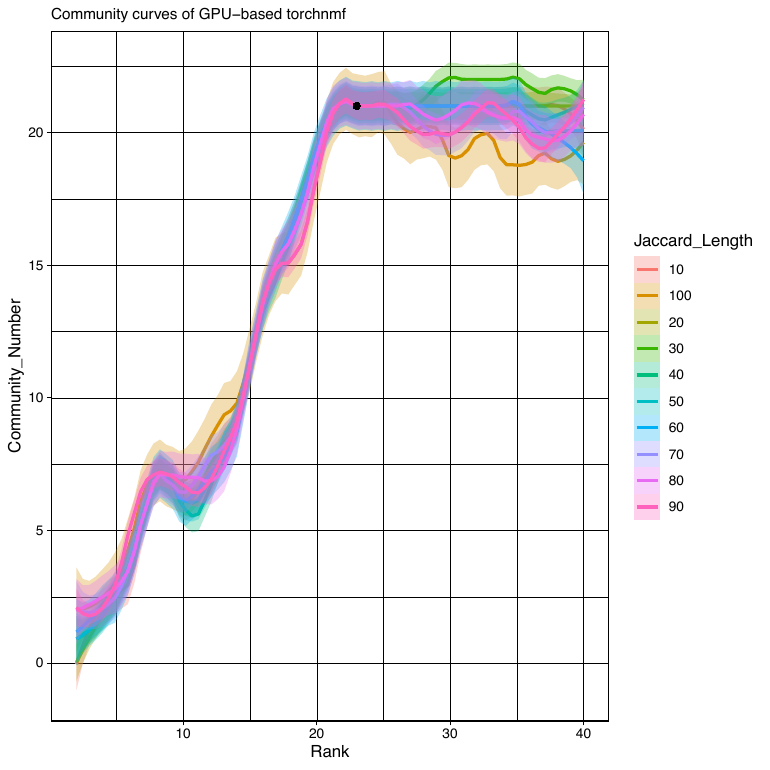

# CSI-GEP tutorial: from raw counts to final GEPs

This walkthrough simulates a small dataset with known gene expression programs, runs the complete CSI-GEP
pipeline on it, and checks the result against the true programs. Every command below was run as written,
with both setup options. The outputs, figure and run times quoted are from the option A (container) run; option B
gave the same 21 GEPs with K = 22 instead of 23 (see step 5).

**You need:** either Singularity/Apptainer or Docker (option A, containers), or conda (option B, install the
environments); ~10 GB disk; a GPU is recommended but optional (CSI-GEP falls back to CPU, much slower). Both options
run the same scripts, and steps 1–7 are identical for both.

**Time:** about 22 min of compute plus queue waiting (46 min in our test) on a cluster running one job per K in
parallel (GPU for NMF); about 8 h if every step runs one after another on a single GPU (see [resources](#running-on-a-cluster)).

---

## How CSI-GEP works (what each step does)

| Step | Option A (containers) | Option B (conda) | What it does | Key output |
|------|------------|------------|----------------------------|-----------|
| [2. Prepare](#2-prepare) | `/app/prepare.py` | `CSI-GEP/prepare.py` | Randomly splits cells into two halves (`split0`, `split1`). In each half: TPM-normalises, picks the `--numgenes` (default 2000) most over-dispersed genes, scales them to unit variance. | `cNMF_split{0,1}/` |
| [3. Factorize](#3-factorize-every-k) | `/app/cNMF.py` | `CSI-GEP/cNMF.py` | For one rank K (`--components`, no default), in each half: runs NMF `--n-iter` (default 100) times (GPU), clusters the replicate spectra into a consensus at two density thresholds (2.0 and 0.1), and scores every gene for every program (`gene_spectra_score`). Run once per K. | `cNMF_split*/cNMF_split*.gene_spectra_score.k_K.dt_0_1.txt` |
| [4. Jaccard](#4-jaccard-test-for-every-k) | `/app/Jaccard.R` | `CSI-GEP/Jaccard.R` | For one K: compares every program in split0 with every program in split1 by the overlap of their top genes (Jaccard test, Bonferroni-corrected) at gene-list lengths ("Jaccard lengths", JL) 10, 20, …, 100. Significant pairs form a network; its communities are programs found reproducibly in both halves. Run once per K. | `results/jaccardtest_results_K<K>.RDS` |
| [5. GEP analysis](#5-select-k-and-build-the-final-geps) | `/app/GEP_analysis.R` | `CSI-GEP/GEP_analysis.R` | Plots community number vs K for each JL, finds the elbow of each curve, and picks the (K, JL) whose curve falls most steeply after its elbow. Each community at that (K, JL) is one final GEP: the average of its member programs' gene scores. | `GEP_results/<name>_community_geps.RDS` |

The Python steps run in the `csi-gep_py` container (option A) or the `csigep_py` environment (option B), the R
steps in `csi-gep_r` or `csigep_r`; see [0. Set up](#0-set-up).

The final result is a **gene × GEP matrix** of program scores (all genes, not only the over-dispersed ones).
CSI-GEP does not output a usage of each final GEP in every cell; per-half usages for the K programs are in
`cNMF_split*/cNMF_split*.usages.k_K.dt_0_1.consensus.txt`.

---

## 0. Set up

```bash
git clone https://github.com/geeleherlab/CSI-GEP && cd CSI-GEP
RUN=$PWD/tutorial_run/          # all output goes here. Keep the trailing slash: the R scripts need it.
mkdir -p ${RUN}data ${RUN}results ${RUN}GEP_results
```

Then set up the software in **one** of two ways. Either way you define three variables, `PY` and `RR` (how to run
Python and R) and `S` (where the CSI-GEP scripts are), and the rest of the tutorial is the same.

### Option A: containers (nothing to install)

```bash
singularity pull docker://ghcr.io/geeleherlab/csi-gep_py:latest    # -> csi-gep_py_latest.sif
singularity pull docker://ghcr.io/geeleherlab/csi-gep_r:latest     # -> csi-gep_r_latest.sif
PY="singularity exec --nv csi-gep_py_latest.sif"                   # --nv gives the container the GPU
RR="singularity exec csi-gep_r_latest.sif"
S=/app                                                             # scripts inside the containers
```

With Docker instead: `PY="docker run --gpus all -v $PWD:$PWD -w $PWD ghcr.io/geeleherlab/csi-gep_py:latest"`, and the
same for `RR` with `csi-gep_r` (no `--gpus`).

### Option B: conda environments (the repository's scripts)

```bash
conda env create -f CSI-GEP/environment_py.yml      # Python 3.7 + torch 1.13.1 (CUDA 11.7), same versions as the container
conda env create -f CSI-GEP/environment_R.yml       # R 4.1
conda activate csigep_r                              # two R packages come from GitHub (same commits as the container)
Rscript -e 'remotes::install_github("ncchung/jaccard@ad1d8fc"); remotes::install_github("ahasverus/elbow@cf58784")'
conda deactivate
PY="conda run -n csigep_py"
RR="conda run -n csigep_r"
S=CSI-GEP                                            # scripts in this repository
```

The GitHub install compiles `jaccard`; run it with `csigep_r` activated so R finds the environment's compilers.
The repository's scripts and the containers' copies are the same code (`cNMF.py` and `Jaccard.R` are identical;
`prepare.py` and `GEP_analysis.R` differ only in formatting and comments).

## 1. Simulate the example data

The demo uses simulated data with known programs, so you can check that CSI-GEP finds them. `tutorial/simulate_demo.py`
uses the same generative model and parameters as the paper's simulation (`simulations.py`), scaled down to
20,000 cells × 10,000 genes with **21 true programs**: 20 cell-identity groups (each with its own up-regulated genes)
and 1 activity program (1,000 genes, used at 10–70% by about a third of the cells in groups 1–4).

```bash
$PY python tutorial/simulate_demo.py ${RUN}data
```

```
Simulated 20,000 cells x 10,000 genes | 20 groups + 1 activity program | activity cells: 1,429 | counts sparse: True
```

Outputs: `demo_counts.h5ad` (raw counts), `ground_truth_programs.tsv` (the genes of each true program) and
`cellparams.csv` (each cell's group and activity usage). The paper's full benchmark dataset (250,000 cells,
41 programs) is on [OSF](https://osf.io/tknm2/); see [Reproduce the paper](#reproduce-the-paper).

**Using your own data:** the input is one `.h5ad` file with **raw counts** (not normalised or log-transformed),
cells as rows, genes as columns, stored as a **sparse** matrix (`prepare.py` stops with an error on a dense
matrix). Do your usual cell and gene QC first.

## 2. Prepare

```bash
$PY python $S/prepare.py --numgenes 2000 -c ${RUN}data/demo_counts.h5ad --output-dir $RUN
```

`--numgenes` is the number of over-dispersed genes used for factorization (2,000 is the default and what the paper
used). Note that each half selects its own gene list.

## 3. Factorize every K

Choose the range of ranks to scan. It must extend well beyond the number of programs you expect, because K is
chosen from where the community curve levels off. This tutorial scans K = 2 to 40 in steps of 1 (`tutorial/K.txt`);
the paper scanned 2–60 in steps of 1 and 70–200 in steps of 10 (`CSI-GEP/K.txt`). Keep steps of 1 around the
expected number of programs: a coarse grid can miss the best K.

```bash
for k in $(cat tutorial/K.txt); do
  $PY python $S/cNMF.py --output-dir $RUN --components $k --n-iter 100
done
```

Each K is independent, so on a cluster submit one job per K (see [Running on a cluster](#running-on-a-cluster)).

## 4. Jaccard test for every K

```bash
for k in $(cat tutorial/K.txt); do
  $RR Rscript --vanilla $S/Jaccard.R $k $RUN
done
```

`Jaccard.R` uses 16 cores. It needs `${RUN}results/` to exist (created in step 0).

## 5. Select K and build the final GEPs

```bash
$RR Rscript --vanilla $S/GEP_analysis.R $RUN demo ${RUN}GEP_results/ $(paste -sd, tutorial/K.txt) 0
```

Arguments: output folder of steps 2–4, a name for the dataset, results folder (trailing slash), the K values as a
comma-separated list, and rescue (`0` = off, `1` = on). **Rescue** runs one more Jaccard round, at the next larger
JL, on the programs left out of the network, and adds any new matches as extra GEPs.

```bash
cat ${RUN}GEP_results/output_summary.txt
```

```
Community_Number: 21
Rank: 23
Jaccard_Length: 100
Rescued more programs: FALSE
Automatically selected rank k = 23
CSIGEP finished!
```

CSI-GEP selected K = 23 and JL = 100 and found **21 GEPs**. K can be larger than the number of GEPs: in this run, three
GEPs each merge three programs (one half split the program in two, and both pieces matched the same program in the
other half), and one split1 program matched nothing (`demo_gepindex.RDS` lists the members of each GEP).

This output is from option A. Option B, run on the same simulated data, selected K = 22 (JL = 100) and also
found 21 GEPs that recover all 21 true programs; NMF starts from random values, so the selected K can differ
slightly between runs.

## 6. Read the results

| File in `GEP_results/` | Contents |
|---|---|
| `output_summary.txt` | selected K, JL and number of GEPs |
| `<name>_community_geps.RDS` | **final GEPs**: genes × GEPs matrix of scores |
| `<name>_Curves.pdf` | community number vs K for each JL; the black point is the selected (K, JL) |
| `<name>_gepindex.RDS` | for each GEP, which split0 and split1 programs (columns at the selected K) it merges |
| `<name>_jaccardtest_communities.RDS` | community number for every (K, JL) |
| `<name>_labels.RDS`, `<name>_optimized_parameters.RDS` | significant program pairs; selected parameters |

In R:

```r
geps <- readRDS("tutorial_run/GEP_results/demo_community_geps.RDS")
dim(geps)                                            # genes x GEPs
top <- apply(geps, 2, function(s) names(sort(s, decreasing = TRUE))[1:20])
top[, 1]                                             # top 20 genes of GEP 1
```

The top genes of each GEP are what you interpret (marker genes, pathway enrichment).

**Check the curves.** `<name>_Curves.pdf` shows, for each JL, how many reproducible GEPs (communities) each K
gives, and marks the (K, JL) that CSI-GEP selected: the JL whose curve falls most steeply after its elbow, at that
curve's elbow. In this simulated demo the programs are cleanly separated, so the curves for all JLs rise to 21 at
about K = 21 and stay close to 21 over a wide range of K; CSI-GEP selected K = 23, JL = 100. In real data the curves
for different JLs can differ in shape and height and need not level off. Note that CSI-GEP only considers
the K values listed in `K.txt`. If the selected K is at the upper end of that range, it may be worth scanning
larger K (steps 3–4 for the new values, then step 5 on all of them).



*`demo_Curves.pdf` from the demo run: number of reproducible GEPs vs K, one line per JL; the black point is the
selected K = 23, JL = 100. Lines are loess-smoothed, so they can overshoot the actual counts (which never exceed 21
here); the exact counts per (K, JL) are in `demo_jaccardtest_communities.RDS`.*

## 7. Check against the truth (simulated data only)

```bash
$RR Rscript --vanilla tutorial/check_ground_truth.R ${RUN}GEP_results/demo_community_geps.RDS \
    ${RUN}data/ground_truth_programs.tsv ${RUN}GEP_results/ground_truth_check.tsv
```

```
GEPs found: 21 | significantly matched to a true program: 21 | true programs recovered: 21 of 21
```

Each of the 21 GEPs matches a different true program: 46–50 of each GEP's top 50 genes belong to its program,
including the activity program (50 of 50), which only 1,429 of the 20,000 cells use. Per-GEP results are in
`GEP_results/ground_truth_check.tsv`.

---

## What next: using the GEPs

CSI-GEP ends with the gene × GEP matrix from step 6. Most analyses then ask two questions:

1. **What is each GEP?** Read it from its genes.
2. **Which cells use it, and how much?** Build a cell × GEP usage table.

### What is each GEP?

Look at each GEP's top-scoring genes (the `top` table from step 6) and ask what they have in common. For example,
with real data (gene names here are illustrations, not demo output):

| Top genes of a GEP | Likely meaning | Type |
|---|---|---|
| CD3E, CD2, TRAC, CD3D, … | T cells | identity |
| COL1A1, DCN, LUM, COL3A1, … | fibroblasts | identity |
| MKI67, TOP2A, CENPF, NUSAP1, … | cell division (G2/M) | activity |
| ISG15, IFIT1, MX1, OAS1, … | interferon response | activity |

**Identity** GEPs mark a cell type; **activity** GEPs mark a process that cells of different types can switch on.

To go beyond a gene list, run enrichment with each GEP's gene scores as the ranking. For example, with pre-ranked
GSEA and the MSigDB Hallmark gene sets (download the `.gmt` file from MSigDB; install `fgsea` if your R
environment does not have it):

```r
library(fgsea)
hallmark <- gmtPathways("h.all.v2024.1.Hs.symbols.gmt")
gsea1 <- fgsea(hallmark, stats = geps[, 1])                    # GEP 1's scores rank the genes
head(gsea1[order(gsea1$padj), c("pathway", "NES", "padj")])    # top pathways, NES > 0 = enriched
```

The demo genes are simulated (`Gene1`, `Gene2`, …), so enrichment does not apply to them; there, step 7 already
tells you which true program each GEP is.

### Which cells use each GEP, and how much?

CSI-GEP does not write a cell × GEP table, but it can be built from files it already wrote. Two facts make this
work:

- **Each cell was analysed in one half** (step 2 split the cells), and that half's run at the selected K gave the
  cell a usage for each of its K programs (`cNMF_split*/cNMF_split*.usages.k_K.dt_0_1.consensus.txt`).
- **Each final GEP is a group of programs** from the two halves; `<name>_gepindex.RDS` lists which.

So a cell's usage of a GEP is the largest of its usages of that GEP's programs in the cell's half.

**Worked example (made-up numbers).** Cell A is in split0. Its usages are 120 for program 4, 50 for
program 11, 30 for program 17 and close to 0 for the rest. The GEP index says:

| GEP | split0 programs | split1 programs |
|---|---|---|
| GEP 2 | 4 | 7 |
| GEP 5 | 11, 17 | 3 |

(GEP 5 has two split0 programs because split0 cut that program in two; see step 5.) Cell A's usages are then:

| GEP | Calculation | Usage of cell A |
|---|---|---|
| GEP 2 | program 4 | 120 |
| GEP 5 | larger of program 11 and program 17 = max(50, 30) | 50 |

A cell in split1 is handled the same way, with the split1 programs.

**The same in R,** for all cells at once:

```r
res <- "tutorial_run/"
K   <- readRDS(paste0(res, "GEP_results/demo_optimized_parameters.RDS"))$Rank   # selected K (23 in the demo)
idx <- readRDS(paste0(res, "GEP_results/demo_gepindex.RDS"))   # one entry per GEP
idx[[1]]                                                       # programs in GEP 1: $Split0 and $Split1

# 1. Read one half's usages (cells x K programs), as CSI-GEP wrote them
read_usage <- function(s) {                                    # s = 0 or 1
  read.delim(sprintf("%scNMF_split%d/cNMF_split%d.usages.k_%d.dt_0_1.consensus.txt", res, s, s, K),
             row.names = 1, check.names = FALSE)
}

# 2. For each GEP, take the largest of its programs' usages in that half
gep_usage <- function(u, half) {
  m <- sapply(idx, function(g) {
    cols <- g[[half]]                                          # this GEP's programs in this half
    if (length(cols) == 0) rep(NA, nrow(u)) else apply(u[, cols, drop = FALSE], 1, max)
  })
  rownames(m) <- rownames(u)
  m
}

# 3. Stack the two halves: one row per cell, one column per GEP
usage <- rbind(gep_usage(read_usage(0), "Split0"), gep_usage(read_usage(1), "Split1"))
colnames(usage) <- paste0("GEP", seq_along(idx))
dim(usage)                                                     # cells x GEPs (20,000 x 21 in the demo)
```

GEP *i* in `usage` is column *i* of `<name>_community_geps.RDS`. A GEP with no program in one half (possible
with rescue on) is `NA` for that half's cells. Usages are not rescaled per cell, so cells with more
transcripts tend to have larger values.

**Using the table.** For example:

```r
main <- colnames(usage)[apply(usage, 1, which.max)]   # each cell's main GEP, e.g. as a cell label
table(main)                                           # how many cells each GEP dominates
hist(usage[, "GEP5"])                                 # how strongly cells use one GEP
```

For an activity GEP, the usage measures how strongly a cell runs that process, so it is often more useful as a
continuous score than as a label.

**Check on the demo.** The simulation saved each cell's true group and activity usage (`cellparams.csv`), so you
can check that the table recovers them:

```r
truth <- read.csv(paste0(res, "data/cellparams.csv"), row.names = 1)
usage <- usage[rownames(truth), ]
act   <- which.max(cor(usage, truth$program_usage, use = "complete.obs"))   # the activity GEP
cat("activity GEP:", colnames(usage)[act],
    "| correlation with true usage:", round(cor(usage[, act], truth$program_usage), 2), "\n")
top1  <- apply(usage[, -act], 1, which.max)                   # each cell's main identity GEP
tab   <- table(truth$group, top1)
cat("cells whose main identity GEP is their group's GEP:", round(sum(apply(tab, 1, max)) / sum(tab), 3), "\n")
```

```
activity GEP: GEP13 | correlation with true usage: 0.67 
cells whose main identity GEP is their group's GEP: 0.963 
```

### Scoring cells that were not in the run

To get usages for other cells (for example, after running CSI-GEP on a downsampled subset), keep the program
spectra fixed (`cNMF_split*/cNMF_split*.spectra.k_K.dt_0_1.consensus.txt`) and fit each cell's usages by
non-negative least squares. The new data must be normalised like `cnmf_tmp/cNMF_split*.norm_counts.h5ad`: the same
over-dispersed genes, each divided by that half's gene standard deviation. Fitting on TPM or log-normalised data
gives usages on the wrong scale.

---

## Running on a cluster

Steps 3 and 4 are one independent job per K; run them in parallel. `tutorial/test_run_lsf.sh` (option A) and
`tutorial/test_run_env_lsf.sh` (option B; it calls the environments' `python`/`Rscript` directly instead of
`conda run`) are the scripts used to test this tutorial on an LSF cluster (one job per step and per K, with
dependencies). The pattern for SLURM is
the same with `sbatch --dependency`. `CSI-GEP/csigep_submit.bsub` and `Docker/csigep_submit.bsub` are the
submission scripts used for the paper.

Measured in the test run (20,000 cells, 2,000 genes, `--n-iter 100`, K = 2–40 in steps of 1 = 39 values from
`tutorial/K.txt`, NVIDIA GPU for NMF). "Summed" is the total compute over all K; with one job per K running in
parallel, the elapsed time for a step is roughly that of its slowest job.

| Step | Jobs | Time per job | Peak memory per job |
|---|---|---|---|
| Simulate | 1 | 1 min | 7.5 GB |
| Prepare | 1 | 22 s | 0.5 GB |
| Factorize (`cNMF.py`) | 1 per K (39) | 7–13 min (6.7 h summed) | 3.7 GB |
| Jaccard (`Jaccard.R`, 16 cores) | 1 per K (39) | 43 s – 6 min, longer for larger K (1.2 h summed) | 9.7 GB |
| GEP analysis | 1 | 47 s | 0.4 GB |

With one job per K in parallel, the longest chain of jobs is about 22 min of compute (simulate, prepare, the slowest
NMF job, the slowest Jaccard job, GEP analysis); in our test the whole demo took 46 min elapsed, the difference being
time spent waiting in the cluster queue.

Each Jaccard job runs K² tests (every split0 program against every split1 program) at each of 10 JLs, so
K = 40 runs 16,000 tests against 1,000 at K = 10. For K well above this tutorial's range, request more time and
memory than the table shows (in the demo, K = 40 took 4 min and 8.6 GB).

## Reproduce the paper

The paper's benchmark is the same pipeline on the full simulated dataset (250,000 cells × 25,000 genes, 41 true
programs) with the paper's K grid:

```bash
wget -O ${RUN}data/counts.h5ad https://osf.io/download/qr5xc/          # 3.2 GB
# then steps 2–5 with -c ${RUN}data/counts.h5ad and CSI-GEP/K.txt instead of tutorial/K.txt
```

The paper's result is in `CSI-GEP/output_for_benchmarking/GEP_results/output_summary.txt`: K = 47, JL = 20,
41 GEPs. With 12.5× more cells, every step except Jaccard needs proportionally more time and memory
(`CSI-GEP/csigep_submit.bsub` requests 100 GB per job).

## Troubleshooting

- **`cannot open file ...results/jaccardtest_results_K...`**: the output folder path is missing its trailing `/`,
  or `results/` does not exist.
- **`Input data has to be sparse!`**: convert the count matrix to sparse (`scipy.sparse.csr_matrix`).
- **`Warning: N cells have zero counts of overdispersed genes`**: remove those cells (or increase `--numgenes`).
- **Rare programs are missed**: a program used by few cells contributes little variance, so its genes may not be among
  the `--numgenes` over-dispersed genes and NMF cannot find it. More cells (or a larger `--numgenes`) help.
- **`GPU not available`**: NMF runs on CPU; add `--nv` (Singularity) or `--gpus all` (Docker) and run on a GPU node.
